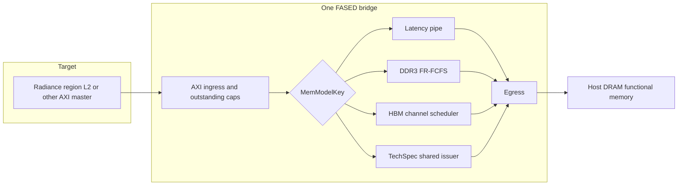

# Modeling architecture

The HBM and DDR3 models stay the timing models they already are. The new work adds one sibling, selected by the same `MemModelKey`, instead of a superclass that all three would have to share.

## Layers

| Layer | Where it lives today | What a new technology is allowed to change |
|---|---|---|
| A. Device timing and organization | `HBMModel`, `FirstReadyFCFSModel`, `LatencyPipe`, `BankConflictModel` | Its own state and runtime registers. |
| B. Controller scheduling | Inside the DRAM models (FR-FCFS window, HBM channel scheduler). The latency pipe has none. | Only if the technology has a scheduler. A byte-addressable part does not get an ACT/PRE scheduler. |
| C. Front-end | `TimingModel` AXI ingress, `SplitTransactionModel` outstanding caps, `FASEDMemoryTimingModel` bridge | Unchanged. Ready still means the model's input queue has room. |
| D. Functional backing memory | Host DRAM behind the egress unit (`UsesHostDRAM`) | Unchanged. The timing model does not store the bytes. |
| E. Technology constraints | HBM refresh and bank timers; DDR3 rank refresh | Endurance and retention for the new model. They are counters, not DRAM commands. |
| F. Instrumentation | AXI transaction counters, occupancy histograms, `HBMREQ` printf | Byte counters, an endurance flag, retention-class counters, optional `TECHSPEC` printf. |

`FASEDMemoryTimingModel` already treats the timing model as a replaceable module: it reads `MemModelKey` and calls `elaborate()`. `WithHBM2FRFCFS` and `WithDDR3FRFCFS` are config fragments that set that key. `WithTechSpecMemory` is the same kind of fragment. `HBM2FRFCFS16GBDualPC` is untouched.



The functional host memory is why a programmed latency is not, by itself, the AXI round trip. The latency pipe already subtracts one egress cycle from the release time (`egressUnitDelay = 1`) and then waits for the host return. The technology-spec model uses that same release formula so it sits in the same place in this pipeline.

## Why the HBM model was not generalized

`HBMModel` encodes pseudo-channels, bank groups, stack ID, REFab/REFSB postponement, and a command bus that Ramulator can replay. Folding a byte-addressable NVM into that state machine would make both models harder to check. A NAND page program is a third schedule, with a different address granule, and does not belong on the AXI beat path as a drop-in DRAM.

The shared piece is the bridge, the outstanding-cap ingress, the egress, and the runtime-register mechanism (`HasProgrammableRegisters`). Each technology keeps its own `BaseConfig` and its own Chisel module.

## Configuration API

Elaboration-time, because they size hardware:

- `TechSpecMemoryConfig.retentionSets`: 0, or a power of two of at least 2. Zero omits the timestamp table.
- `TechSpecMemoryConfig.retentionGranularityBytes`: power-of-two byte granule, default 64.
- `TechSpecMemoryConfig.requestTrace`: when true, `traceEnable` can print one `TECHSPEC` line per admission.
- `BaseParams.maxReads` and `maxWrites`: pipe depths. `TechSpecByteNVM` sets both to 32 through `WithFuncModelLimits`.

Runtime, `+mm_<field>_0=...` for bridge 0:

| Register | Default | Unit |
|---|---:|---|
| `readMaxReqs`, `writeMaxReqs` | 32 on `TechSpecByteNVM` | outstanding AXI requests |
| `readLatency`, `writeLatency` | 30 | target cycles, latency-pipe convention |
| `readServiceCycles`, `writeServiceCycles` | 1 | minimum issuer occupancy |
| `enduranceLimitBytes` | 0 | device write bytes; 0 disables the flag |
| `retentionCycles` | 0 | target cycles; 0 disables classification |
| `traceEnable` | 0 | ignored unless elaborated with `requestTrace` |

The checked-in card is `sim/custom-runtime-configs/techspec-illustrative-byte-nvm.conf`. Platform configs are `TechSpecByteNVM`, `TechSpecByteNVMTrace`, and fasedtests `TechSpecF2Config`. `PointerChaserTechSpec` selects the model for the existing pointer-chaser target and is not in the default test list.

## Issuer rule

One shared issuer orders a same-cycle read ahead of a same-cycle write.

```
occupancy = max(programmedServiceCycles, axiLen + 1)
start     = max(tCycle, nextService)
release   = start + latency - 1
nextService advances by occupancy
```

`axiLen + 1` is the beat count on a port that can move one beat per target cycle. The programmed service is a minimum device time. The two terms are not added, so a 4-beat burst with service 1 occupies 4 cycles, and service 4 occupies 4 cycles as well.

Outstanding caps still use `SplitTransactionModel`. AXI ready goes low when that cap is full. Ready does not look at the issuer, so a request can be admitted before its `start` cycle and wait inside the pipe. The cap decrements in Chisel when the target AXI response completes. The Python reference decrements when the timing model presents the response. Those are different boundaries. `VALIDATION.md` keeps them apart.

## Endurance and retention

Endurance is two 64-bit byte counters that step together. Logical write bytes equal device write bytes. Write amplification is not modeled, because this slice has no measured amplification to apply. A nonzero `enduranceLimitBytes` sets `enduranceExceeded` when a write would pass the budget. The write still completes on the same cycle. The flag does not drop, corrupt, or stall. A zero budget leaves the flag clear.

Retention is a direct-mapped table of the cycle on which a write was admitted, one entry per set, tagged at `retentionGranularityBytes`. A later read of a hit is fresh when `age <= retentionCycles` and stale when `age` is greater. A miss or a tag conflict increments `retentionUnknownReads`. A miss is not an error and is not a stale read. The table never writes the functional memory and never changes `release`. At 64 sets and a 32-bit address with a 64-byte granule, the table is 64 tags and 64 timestamps. It is a sample. Conflict misses forget a line. That is the accuracy cost of not tracking every byte. `retentionSets = 0` or `retentionCycles = 0` performs no classification.

## What this API will not be asked to do

It will not turn a NAND page program into an AXI beat. A later page-level model would be another `MemModelKey` with its own granule and a documented address map. It will not attach energy. The spec field for energy is null until a measured energy exists. It will not replace `HBMModel`.
