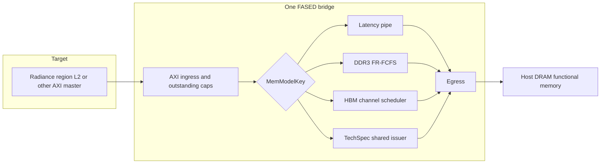
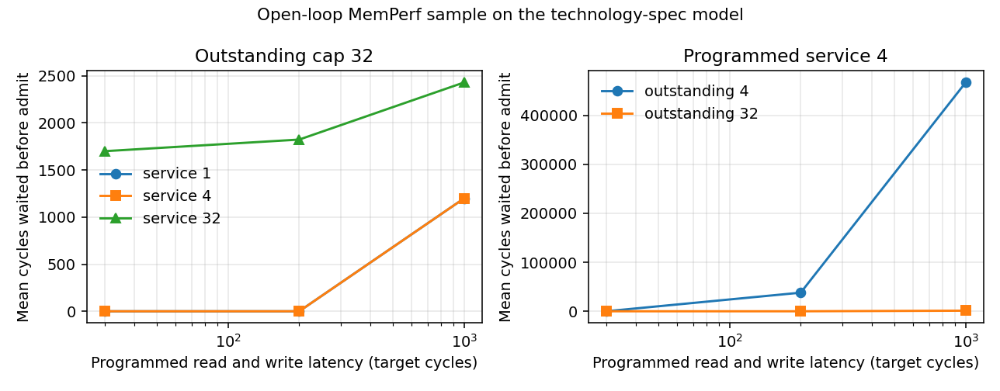

# Emerging-memory modeling writeup

9 November 2026. This is the combined note from the FireSim / FASED session. The source checkouts are under `/global/home/tamzid_razzaque/sagar_memory/`. `qp_accelerator` was not modified.

The session added a byte-addressable technology-spec timing model beside the existing HBM2 model. The HBM2 RTL was not edited. The new card is an illustrative sensitivity study, not a measured device. No FPGA was programmed.

The FeFET Spectre study was already on disk and was not rerun. Spectre on this machine is 25.1.0.340.isr8 at `/usr/eesww/cadence/SPECTRE251/tools/bin/spectre`. Native BSIM-FEBDMC results are in `/global/home/tamzid_razzaque/fifth_yr_memory/experiments/native_spectre_fefet/`. The original Verilog-A hits an `idt()` limit; a one-integrator copy is documented in `MODEL_CHANGES.md`. Frozen-polarization strings through N=32 keep an approximately `1/N` current trend, with a steeper pass resistance than the Python surrogate. Default `TAU0 = 100 ps` still moves the negative polarization on a nanosecond-to-100 ns scale. That is not a calibrated retention time, and it is not an input to the architectural card below.

## 1. Existing FireSim / Radiance / HBM infrastructure

Audit date: 2026-11-09. None of these checkouts is the Chipyard tree that last ran on the FPGA host, and the FireSim checkout is ahead of the Chipyard gitlink.

### Checkouts

| Tree | Remote | Branch | Commit | What was initialized |
|---|---|---|---|---|
| `firesim` | `tamzidrazzaque/firesim` | `investigation/hbm2-fixed-work` | `8ee723921fc695874e53fc303cc4293df3f2eba9` | Sources plus `sim/cde` `2bcaeae2`, `sim/diplomacy` `a042ff6d`, `sim/berkeley-hardfloat` `26f00d00`, `sim/rocket-chip` `1b9f43352`. Platform FPGA submodules were left uninitialized. |
| `chipyard` | `tamzidrazzaque/chipyard` | `investigation/hbm2-u250-handoff-20261022` | `c2ba24424ce8b1a448d9502f44c17e009dbf2050` | This commit only. Submodules were not checked out. |
| `radiance` | `tamzidrazzaque/radiance` | `investigation/hbm2-u250-dependency-20261022` | `bd6c4b7af8fc90b939061862baa35c2f200899cd` | This commit only. |
| `radiance-kernels` | `tamzidrazzaque/radiance-kernels` | `hbm-gemm-e2e` | `e7dfda4425a018d1a10ce9dc070cda8f358bc265` | This commit only. |

FireSim `8ee72392` (2026-11-08, "Add an HBM4-8000 timing table beside the HBM2 tables") is the latest HBM branch tip. The Chipyard handoff's `sims/firesim` gitlink is `097593341ca1b249b4f92d455d982dcbd668f68d`. Its `generators/radiance` gitlink is `bd6c4b7a`, matching the Radiance clone. `chipyard/investigation/README.md` in that same commit still names FireSim `590ebc4e7e1061a7b96bb333b7c692701a791bac`. The gitlink is the pin that a submodule update would use. The prose in that README is older than the gitlink.

The new technology-spec model is an uncommitted change on top of FireSim `8ee72392`. It is not in the Chipyard handoff.

### Memory-model code

FASED timing models are selected by `firesim.configs.MemModelKey` in `firesim/sim/midas/src/main/scala/configs/FASEDTargetConfigs.scala`. `FASEDMemoryTimingModel` calls `cfg.elaborate()` and attaches the host-DRAM functional memory behind the timing model (`firesim/sim/midas/src/main/scala/midas/models/dram/FASEDMemoryTimingModel.scala`).

| Model | Source | What it times |
|---|---|---|
| Latency pipe | `LatencyBandwidthPipe.scala` | Programmable read and write latency. Despite the class name, it has no separate bandwidth limit. Defaults are 30 target cycles. |
| Bank conflict | `BankConflictModel.scala` | Per-bank queues. |
| DDR3 FCFS | `FIFOMASModel.scala` | FIFO command schedule over the DDR3 bank tracker. |
| DDR3 FR-FCFS | `FRFCFSModel.scala`, `DramCommon.scala` | First-ready FR-FCFS, ACT/PRE/CAS, rank refresh. Runtime example: `sim/custom-runtime-configs/ddr3-FRFCFS-8G-4R-2133-OP-5bridge.conf`. |
| HBM | `HBMModel.scala` | Independent channels. Each channel has pseudo-channels, bank groups, banks, FR-FCFS, REFab/REFSB, and a completion pipe. |

There is no DDR4 or DDR5 FASED timing model. The only DDR4 hit in this FireSim tree is a board-port note in `platforms/corigine_xb10/PORTING.md`. No HyperRAM or RPC DRAM model is in these checkouts.

### HBM2 timing and organization

`HBMModel.scala` is still the HBM2 (JESD235) state machine. Speed tables in `HBMTimingTables` are controller-clock counts:

- `hbm2_2400`, `hbm2_2000`, `hbm2_1600`
- `pare`, currently an alias of `hbm2_2400`
- `hbm4_8000`, added in `8ee72392`, from printed JESD270-4A values plus documented fills from HBM2-2000 nanoseconds and Table 99. `tBL` and `tCMD` are the existing model's burst and command slots.

`HBM4FRFCFS16HiQuadChannel` only changes organization: 8 bank groups, 8 banks per group, 4 channels. `HBM2FRFCFS8HiQuadChannel` is the 8-high, 32-bank organization with one stack-ID bit and a `tCCDR` register. Neither config replaces the HBM2 command path with an HBM4 bus.

Platform classes used by the existing study:

- `HBM2FRFCFS16GBDualPC`: one channel, two pseudo-channels, 16 banks per pseudo-channel, 32/32 read/write entries.
- `HBM2FRFCFS16GBQuadChannel`: four channels inside one `HBMModel`.

Checked-in runtime cards include `sim/custom-runtime-configs/hbm2-FRFCFS-2000-OP-REFSB-5bridge.conf` and the 2400 REFab/REFSB single- and four-channel cards. A five-bridge file programs five FASED instances. The HBM validation README says an unsuffixed template now fails closed; bridge index suffixes are required.

### What one HBM port is

The HBM model consumes timing counts on the target clock. `chipyard/investigation/README.md` records that `WithFireSimConfigTweaks` drives the memory bus at 1 GHz, while the HBM2-2400 table is counted at 0.833 ns. Using those counts on a 1 ns tick stretches modeled time by about 1.20x. The same note says `WithEdgeDataBits(64)` is an 8-byte beat in the source config.

A FASED AXI port's delivered bytes per target cycle are therefore not the HBM stack's pin bandwidth. The fixed-read diagnostic below is the evidence for that.

### Radiance connection

`radiance/chipyard/RadianceRegionMem.scala` (`WithRadianceRegionMemPunchthrough`) exports one AXI4 memory port per Radiance region. The harness receives the whole `ExtMem` range for the backing image. Per-region timing is selected by the FASED bridge on that port.

`chipyard/generators/firechip/chip/src/main/scala/TargetConfigs.scala` instantiates the FireSim Radiance targets, including:

- `FireSimE4M3MxGemminiRadianceConfig` and the two- and four-cluster variants
- `FireSimE4M3MxGemminiHBMRadianceConfig` and `FireSimE4M3MxGemminiTwoClusterHBMRadianceConfig`
- `FireSimE4M3MxGemminiTwoClusterHBMHighDepthRadianceConfig`, which raises L0/L1 in-flight and MSHR counts on the two-cluster HBM target

`chipyard/investigation/README.md` states the topology that those HBM configs use: one 256 KiB host L2 slice plus four 64 KiB GPU L2 slices, five region AXI ports, GPU lines hashed across the four GPU regions. The ordinary target is one memory channel behind a shared 512 KiB L2. Those are different cache designs. A DDR-versus-HBM comparison that also changes the L2 is not a memory-model-only comparison.

In this project one SM is one Radiance cluster, and a cluster has two Muon cores. The two-SM target is four Muon cores. Source for that naming is `chipyard/investigation/workloads.md`.

### Validation already in the HBM branch

`firesim/sim/scripts/hbm-validation/README.md` describes the Ramulator 2.1 legality flow. Pinned Ramulator commit recorded there: `b30320bc9385b708e86b67ebb9f48858cc66d798`. The check replays FASED command traces into Ramulator's HBM2 device. It checks that FASED did not issue a command early. It does not require the two schedulers to match cycle for cycle.

The same directory holds:

- `examples/radiance-memperf-reqtrace-sample.csv`, 5000 HBMREQ rows from a Radiance MemPerf run
- `examples/radiance-memperf-segments.txt`, segment statistics for a 613,255-request, 24M-cycle run that the README reports as 0 Ramulator violations

`sim/midas/src/test/scala/midas/HBMModelSpec.scala` elaborates the HBM and DDR3 FR-FCFS models and checks the HBM2 and HBM4-8000 tables. That spec was not re-run in this session. The new `TechSpecMemorySpec` is the spec this session added.

### Results already measured, and what they are

These numbers are copied from the Chipyard investigation notes. They were not reproduced on this machine. No FPGA was programmed here.

From `chipyard/investigation/hbm-fixed-work-diagnostic-2026-10-21.md`, host Verilator, three identical repeats, 32,768 sequential 32-byte reads, equal port counts. Effective GB/s assumes a 1 GHz target tick:

| Model / ports | Target cycles | GB/s at 1 GHz | Versus the matching DDR run |
|---|---:|---:|---:|
| DDR3-2133 / 1 | 142,897 | 7.338 | baseline |
| HBM2-2000 / 1 | 145,354 | 7.214 | 1.719% more cycles |
| HBM2-2400 counts on a 1 GHz tick / 1 | 145,528 | 7.205 | 1.841% more cycles |
| DDR3-2133 / 4 | 35,696 | 29.375 | baseline |
| HBM2-2000 / 4 | 36,331 | 28.862 | 1.779% more cycles |

One 8-byte FASED port is the limiter. HBM2 is not faster than DDR3 on this sequential probe. A non-physical `tREFI=30000` run made HBM2-2000 faster than DDR, which the note uses as evidence that refresh, not the completion backend, causes most of the valid-profile gap. Sequential REFSB was much slower (246,343 one-port cycles). The same addresses in bank-interleaved order made REFSB faster than REFab (131,299 one-port cycles) with zero Ramulator violations on that trace.

From `chipyard/investigation/README.md`, host-Verilator two-SM STREAM Copy smokes, same pinned ELF. These prove the target boots and the profiles load. The kernel is tiny. Host wall time is not XB10 performance.

| Profile | Total target cycles | Kernel cycles |
|---|---:|---:|
| HBM2-2400 | 395,266 | 13,670 |
| HBM2-2000 | 392,194 | 12,682 |
| DDR3-2133 | 386,050 | 11,538 |

`chipyard/investigation/workloads.md` records the native STREAM and Spatter matrix (Copy/Scale/Add/Triad and Spatter 0-4) and the ELF hashes. Those ELFs are not in the `hbm-gemm-e2e` kernel clone used here. That clone contains `soc/muon.elf` only. No new ELF was built and no workload was launched.

### Clocks, cycles, and bandwidth, kept separate

- **Memory-model latency** is a count of target cycles inside the FASED timing model (tCAS, the latency pipe's `readLatency`, or the new model's release formula).
- **Simulated target cycles** are the cycles reported by the FireSim target, including the core, caches, and every bridge.
- **Physical DRAM time** is the JEDEC nanosecond value. Dividing by the real tCK produces the table in `HBMTimingTables`. Applying that table on a 1 ns model tick is a different physical time than HBM2-2400.
- **FPGA host clock** is the clock of the emulator. It is not the 1 GHz target tick. This session did not run on an FPGA, so no host-clock measurement was taken.
- **GPU cycles** in the STREAM smoke are the kernel-cycle column above, not the total target-cycle column.
- **AXI / backing-memory throughput** is what the 8-byte FASED port and the host DRAM functional model actually move. The fixed-read table is that quantity. It is not an HBM stack's advertised pin bandwidth.

### What is already solved, and what is missing

Solved in the existing branch: an HBM2 FR-FCFS model with multi-channel organization, HBM2-1600/2000/2400 tables, an HBM4-8000 table and 16-high organization on that same machine, DDR3 FR-FCFS, runtime profiles for five bridges, Ramulator legality checks, and Radiance region ports that can host one FASED model per region.

Missing for the Sagar direction: a non-DRAM technology card, endurance and retention accounting that does not pretend to be DRAM refresh, a closed-loop run in which only that card changes, and any calibrated FeFET or other emerging-device numbers. DDR5 is also absent. The Chipyard handoff does not yet point at FireSim `8ee72392`, so the HBM4 table and the new model are not what the last handoff document describes.

## 2. Modeling architecture

The HBM and DDR3 models stay the timing models they already are. The new work adds one sibling, selected by the same `MemModelKey`, instead of a superclass that all three would have to share.

### Layers

| Layer | Where it lives today | What a new technology is allowed to change |
|---|---|---|
| A. Device timing and organization | `HBMModel`, `FirstReadyFCFSModel`, `LatencyPipe`, `BankConflictModel` | Its own state and runtime registers. |
| B. Controller scheduling | Inside the DRAM models (FR-FCFS window, HBM channel scheduler). The latency pipe has none. | Only if the technology has a scheduler. A byte-addressable part does not get an ACT/PRE scheduler. |
| C. Front-end | `TimingModel` AXI ingress, `SplitTransactionModel` outstanding caps, `FASEDMemoryTimingModel` bridge | Unchanged. Ready still means the model's input queue has room. |
| D. Functional backing memory | Host DRAM behind the egress unit (`UsesHostDRAM`) | Unchanged. The timing model does not store the bytes. |
| E. Technology constraints | HBM refresh and bank timers; DDR3 rank refresh | Endurance and retention for the new model. They are counters, not DRAM commands. |
| F. Instrumentation | AXI transaction counters, occupancy histograms, `HBMREQ` printf | Byte counters, an endurance flag, retention-class counters, optional `TECHSPEC` printf. |

`FASEDMemoryTimingModel` already treats the timing model as a replaceable module: it reads `MemModelKey` and calls `elaborate()`. `WithHBM2FRFCFS` and `WithDDR3FRFCFS` are config fragments that set that key. `WithTechSpecMemory` is the same kind of fragment. `HBM2FRFCFS16GBDualPC` is untouched.



The functional host memory is why a programmed latency is not, by itself, the AXI round trip. The latency pipe already subtracts one egress cycle from the release time (`egressUnitDelay = 1`) and then waits for the host return. The technology-spec model uses that same release formula so it sits in the same place in this pipeline.

### Why the HBM model was not generalized

`HBMModel` encodes pseudo-channels, bank groups, stack ID, REFab/REFSB postponement, and a command bus that Ramulator can replay. Folding a byte-addressable NVM into that state machine would make both models harder to check. A NAND page program is a third schedule, with a different address granule, and does not belong on the AXI beat path as a drop-in DRAM.

The shared piece is the bridge, the outstanding-cap ingress, the egress, and the runtime-register mechanism (`HasProgrammableRegisters`). Each technology keeps its own `BaseConfig` and its own Chisel module.

### Configuration API

Elaboration-time, because they size hardware:

- `TechSpecMemoryConfig.retentionSets`: 0, or a power of two of at least 2. Zero omits the timestamp table.
- `TechSpecMemoryConfig.retentionGranularityBytes`: power-of-two byte granule, default 64.
- `TechSpecMemoryConfig.requestTrace`: when true, `traceEnable` can print one `TECHSPEC` line per admission.
- `BaseParams.maxReads` and `maxWrites`: pipe depths. `TechSpecByteNVM` sets both to 32 through `WithFuncModelLimits`.

Runtime, `+mm_<field>_0=...` for bridge 0:

| Register | Default | Unit |
|---|---:|---|
| `readMaxReqs`, `writeMaxReqs` | 32 on `TechSpecByteNVM` | outstanding AXI requests |
| `readLatency`, `writeLatency` | 30 | target cycles, latency-pipe convention |
| `readServiceCycles`, `writeServiceCycles` | 1 | minimum issuer occupancy |
| `enduranceLimitBytes` | 0 | device write bytes; 0 disables the flag |
| `retentionCycles` | 0 | target cycles; 0 disables classification |
| `traceEnable` | 0 | ignored unless elaborated with `requestTrace` |

The checked-in card is `sim/custom-runtime-configs/techspec-illustrative-byte-nvm.conf`. Platform configs are `TechSpecByteNVM`, `TechSpecByteNVMTrace`, and fasedtests `TechSpecF2Config`. `PointerChaserTechSpec` selects the model for the existing pointer-chaser target and is not in the default test list.

### Issuer rule

One shared issuer orders a same-cycle read ahead of a same-cycle write.

```
occupancy = max(programmedServiceCycles, axiLen + 1)
start     = max(tCycle, nextService)
release   = start + latency - 1
nextService advances by occupancy
```

`axiLen + 1` is the beat count on a port that can move one beat per target cycle. The programmed service is a minimum device time. The two terms are not added, so a 4-beat burst with service 1 occupies 4 cycles, and service 4 occupies 4 cycles as well.

Outstanding caps still use `SplitTransactionModel`. AXI ready goes low when that cap is full. Ready does not look at the issuer, so a request can be admitted before its `start` cycle and wait inside the pipe. The cap decrements in Chisel when the target AXI response completes. The Python reference decrements when the timing model presents the response. Those are different boundaries. Section 5 keeps them apart.

### Endurance and retention

Endurance is two 64-bit byte counters that step together. Logical write bytes equal device write bytes. Write amplification is not modeled, because this slice has no measured amplification to apply. A nonzero `enduranceLimitBytes` sets `enduranceExceeded` when a write would pass the budget. The write still completes on the same cycle. The flag does not drop, corrupt, or stall. A zero budget leaves the flag clear.

Retention is a direct-mapped table of the cycle on which a write was admitted, one entry per set, tagged at `retentionGranularityBytes`. A later read of a hit is fresh when `age <= retentionCycles` and stale when `age` is greater. A miss or a tag conflict increments `retentionUnknownReads`. A miss is not an error and is not a stale read. The table never writes the functional memory and never changes `release`. At 64 sets and a 32-bit address with a 64-byte granule, the table is 64 tags and 64 timestamps. It is a sample. Conflict misses forget a line. That is the accuracy cost of not tracking every byte. `retentionSets = 0` or `retentionCycles = 0` performs no classification.

### What this API will not be asked to do

It will not turn a NAND page program into an AXI beat. A later page-level model would be another `MemModelKey` with its own granule and a documented address map. It will not attach energy. The spec field for energy is null until a measured energy exists. It will not replace `HBMModel`.

## 3. Technology specification

Version 1 of the card is `firesim/sim/scripts/emerging-memory/specs/illustrative_byte_addressable_nvm.json`. The Chisel register defaults and `techspec-illustrative-byte-nvm.conf` carry the same numbers. The status of every number in that card is **illustrative sensitivity**. Nothing in it was measured on a device.

### Where each field lives

| Field | Layer | Status in the v1 card |
|---|---|---|
| `technology_name`, `spec_version`, `provenance`, `calibration_status` | measurement metadata | illustrative-byte-addressable-nvm, version 1 |
| `addressability`, `organization` | device model | byte address, no banks and no pages |
| `read_latency_cycles`, `write_latency_cycles` | device timing, programmed into the timing model | 30 target cycles, the existing latency-pipe default |
| `read_service_cycles`, `write_service_cycles`, `issuer_occupancy_rule` | device timing | service 1; occupancy is `max(service, axi_len+1)` |
| `outstanding_reads`, `outstanding_writes` | controller / bridge queue | 32, from `WithFuncModelLimits` |
| `data_width_bytes_assumed_by_replay`, `axi_size_assumed_by_replay` | system interface assumption used only by the open-loop replay | 8-byte beats, AXI size 3 |
| `endurance_limit_bytes`, `endurance_policy` | reliability model | limit 0, account only |
| `write_amplification` | reliability model | null. The implementation forces logical and device write bytes to match. |
| `retention_cycles`, `retention_sets`, `retention_granularity_bytes`, `retention_policy` | reliability model | window 0 so classification is off; the hardware can hold 64 sets of 64-byte lines |
| `energy_per_read_joules`, `energy_per_write_joules`, `temperature` | not modeled | null |

A published JEDEC table, such as the HBM2-2400 counts already in `HBMTimingTables`, stays in the DRAM model. It is not copied into this card. An extrapolation or a sensitivity knob has to say so in `calibration_status`. The v1 card says `illustrative-sensitivity`.

### Policies that are part of the spec

**Endurance.** The model counts AXI write bytes at the cycle a write is admitted to the issuer (`(axi_len+1) << axi_size`). That count is both the logical write traffic and the device write traffic. When the programmed budget is nonzero and the next write would pass it, `enduranceExceeded` sticks at 1. Timing and data are unchanged. The model does not remap, wear-level, or fail the write. Spatial hot spots are invisible: the counter is the whole device.

**Retention.** The model does not flip bits when a window expires. With a nonzero window and a nonzero set count, it classifies admitted reads against a direct-mapped timestamp sample. Unknown means "this line is not in the sample," which includes lines that were never written in the sample and lines evicted by a conflict. Unknown is not a detected error. The timestamp is the admit cycle of the write, not a separate program-complete event.

**Functional data.** Bytes live in the FASED host-DRAM backing store. This spec does not describe that store and does not inject errors into it.

### What is deliberately absent

No FeFET read current, memory window, `TAU0`, endurance cycle rating, or retention time is in the card. Native Spectre already runs in `fifth_yr_memory`, and the retention behavior under the model's default `TAU0` of 100 ps is not a calibrated memory lifetime. Professor Salahuddin has said that calibration still needs the right person. This framework does not wait on that calibration and does not treat a frozen-polarization current as a retention result.

A later calibrated card can replace the JSON and the `+mm_*` values without a new Chisel class, as long as the device remains byte-addressable and the occupancy rule still describes it. A page-programmed NAND or a FeNAND string is a different organization and needs a different model. The native string study is evidence about cell current versus string length. It is not a system address map.

### Route from a device result to this card

1. A Spectre or measured distribution produces a latency, a service time, and a retention or endurance distribution at a stated temperature and bias.
2. The distribution is reduced to a card whose `calibration_status` says measured, published, extrapolated, or illustrative, with the source named in `provenance`.
3. The card is written as `+mm_*` registers on a FASED bridge.
4. A closed-loop workload reports target cycles, admit stalls, and the model's own counters.

Step 2 is where a sensitivity range is allowed. The v1 card is that kind of range, and the only range varied in the study below is latency, service, and outstanding depth. Endurance and retention stay at their disabled defaults in the replay, so the replay is not a reliability result.

## 4. First implementation

The first slice is a byte-addressable technology-spec timing model next to the existing HBM and DDR3 models. It is the smallest model that can carry a non-DRAM card, including endurance and retention accounting, and that can be checked without an FPGA.

### Why this slice, and not the others

DDR5 would be another DRAM table on the FR-FCFS machine. The branch already grew that way on 8 November: `hbm4_8000` is a table on `HBMModel`, and `HBM4FRFCFS16HiQuadChannel` is an organization change. A second DRAM grade does not create a place to put endurance or a non-DRAM address model.

An endurance wrapper around HBM would edit the model Ramulator is used to check. The HBM counters and refresh behavior would have to be re-proven. The new counters sit on a new module instead.

A 3D NAND page model needs a page/block address map and program/erase timing we do not have a calibrated source for. Putting that behind an AXI byte port would claim the GPU can use NAND as DRAM. Sagar asked for technology models without prescribing that hookup.

The technology-spec model is a `TimingModel` with a shared issuer, separate read and write latencies, a beat-aware occupancy, and reliability counters that do not change data. A later DDR5 table can still be added as DRAM. A later NAND model can still be added as its own key. A calibrated FeFET card, when one exists, drops into this key if the cell is used as a byte-addressable memory. If it is used as a string, it does not.

### Files

| Path | Role |
|---|---|
| `sim/midas/src/main/scala/midas/models/dram/TechSpecMemory.scala` | Chisel timing model |
| `sim/midas/src/main/scala/configs/FASEDTargetConfigs.scala` | `WithTechSpecMemory`, `TechSpecByteNVM`, `TechSpecByteNVMTrace` |
| `sim/src/main/scala/fasedtests/Config.scala` | `TechSpecF2Config` |
| `sim/src/main/scala/midasexamples/Config.scala` | `PointerChaserTechSpec` |
| `sim/midas/src/test/scala/midas/TechSpecMemorySpec.scala` | Elaboration and config identity |
| `sim/custom-runtime-configs/techspec-illustrative-byte-nvm.conf` | One-bridge runtime card |
| `sim/scripts/emerging-memory/techspec.py` | Cycle-accurate reference of the timing-model rules |
| `sim/scripts/emerging-memory/test_techspec.py` | Directed tests of those rules |
| `sim/scripts/emerging-memory/replay_trace.py` | Open-loop replay of the MemPerf sample |
| `sim/scripts/emerging-memory/specs/illustrative_byte_addressable_nvm.json` | Versioned card |

`HBMModel.scala` and the HBM platform classes were not edited.

### Counters

On the timing-model register block:

- `admittedReads`, `admittedWrites`
- `deviceReadBytes`, `deviceWriteBytes`, `logicalWriteBytes` (the last two match)
- `issuerBusyCycles`
- `enduranceExceeded`
- `retentionFreshReads`, `retentionStaleReads`, `retentionUnknownReads`

The existing FASED transaction and beat counters remain, because `TechSpecByteNVM` sets `beatCounters`. `totalWrites` still counts AW acceptance. `admittedWrites` counts the cycle when AW and the last W beat have both arrived. Those differ if the address arrives early.

Optional trace, only if elaborated with `requestTrace` and `traceEnable=1`:

```
TECHSPEC,<cycle>,<isWrite>,<addr>,<id>,<len>,<size>,<start>,<release>
```

### Reproduce the reference

From `firesim/sim/scripts/emerging-memory`:

```bash
python3 -m unittest test_techspec.py
python3 replay_trace.py
```

The replay writes `research/emerging_memory/results/techspec_sample_sensitivity.json` and, if matplotlib imports, `techspec_sample_sensitivity.png`.

Chisel elaboration, from `firesim/sim`, with JDK 17. This machine's default `java` is 8, which this build does not use. The JDK and sbt used here are under `/global/home/tamzid_razzaque/sagar_memory/toolchains/`.

```bash
export JAVA_HOME=/global/home/tamzid_razzaque/sagar_memory/toolchains/jdk-17
export PATH="$JAVA_HOME/bin:/global/home/tamzid_razzaque/sagar_memory/toolchains/sbt/bin:$PATH"
cd /global/home/tamzid_razzaque/sagar_memory/firesim/sim
sbt -batch "midas/testOnly goldengate.tests.TechSpecMemorySpec"
```

A metasim of `TechSpecF2Config` was not run. An FPGA image was not built.

## 5. Validation

Base commit before these edits: FireSim `8ee723921fc695874e53fc303cc4293df3f2eba9`. The model and tests are uncommitted on that commit. Python 3 on this machine ran the reference. JDK is Temurin 17.0.21. sbt is 1.10.1. Matplotlib wrote the sensitivity figure.

### What the Python reference checks

`test_techspec.py` passed 13 tests in one run, and the determinism test runs the same stimulus twice.

| Check | Result |
|---|---|
| Single-beat latency 1 releases on the admit cycle (`start + 1 - 1`) and completes in that cycle because the pipe flows | passed |
| Latency 30 releases at `start + 29` | passed |
| A 4-beat burst with service 1 occupies 4 cycles; the next burst starts 4 cycles later | passed |
| Same-cycle read starts before the write; the overlap checker accepts that schedule | passed |
| AW one cycle before the last W beat admits the write on the second cycle | passed |
| With one outstanding entry, a second read is refused on the completion cycle and admitted the cycle after | passed |
| A sink that is not ready holds the head and the outstanding count | passed |
| Two writes past a one-transfer endurance budget set the flag and keep the same release cycles | passed |
| Retention: age greater than the window is stale; age equal to the window is fresh; a conflicting tag is unknown; a zero window does not classify | passed |
| Two 64-byte addresses in one granule share a set index | passed |
| A hand-written overlap is reported, and a back-to-back legal pair is not | passed |
| `advance_to` matches cycle-by-cycle stepping on a mixed schedule, including issuer-busy counts | passed |
| A second run of one mixed schedule matches the first | passed |

The overlap checker is the intentional-violation test. The model is expected to emit an empty violation list. A schedule with starts at 0 and 2, each of occupancy 4, is reported.

### What the Python reference does not check

It does not drive Chisel. Outstanding counts in Python drop when the timing-model response is accepted. In `TimingModel`, `pendingReads` drops when the target R channel fires its last beat, after the egress unit and the host functional memory. A Python queue-full cycle is the timing-model boundary. It is not yet a measured AXI-port cycle.

The reference does not contain the HBM or DDR3 command timers. It does not check functional bytes. Those bytes stay in the host backing store, which this session did not simulate.

Address mapping for the retention sample is the shift-and-mask in `retention_index`. There is no bank map to compare to HBM.

### Chisel spec

Command, from `firesim/sim`, JDK Temurin 17.0.21, sbt 1.10.1:

```bash
sbt -batch "midas/testOnly goldengate.tests.TechSpecMemorySpec"
```

Result on 2026-11-09: **5 succeeded, 0 failed**, sbt `[success]` in 119 s. The spec elaborates `TechSpecMemoryModel` to Verilog with the 64-set retention table and the request trace, elaborates it again with the table and the trace removed, checks the illustrative register defaults, checks that `TechSpecByteNVM` selects `TechSpecMemoryConfig` with 32/32 entries and tracing off, and checks that `HBM2FRFCFS16GBDualPC` still selects an `HBMModelConfig` with one channel, two pseudo-channels, 16 banks per pseudo-channel, and tracing off.

Elaboration means the module builds and those config keys are intact. It does not mean the Chisel schedule matches `techspec.py`. That match is by construction of the two implementations and is unchecked until a metasim trace is diffed. The compile emitted the usual Chisel 3.6 deprecation warnings from Rocket Chip. They were not treated as errors.

### HBM behavior

No HBM RTL was edited. The spec above instantiates the existing `HBM2FRFCFS16GBDualPC` key and checks its organization fields. The Ramulator flow was not re-run. The previous 0-violation claim remains the claim in `sim/scripts/hbm-validation/README.md`, not a new measurement.

### Replay sanity

`replay_trace.py` refuses a trace that is not ordered by cycle, refuses an issuer schedule with overlapping service windows, and refuses to finish if any request was not admitted. The 18-point sample run completed and wrote the JSON cited in the workload section. Service 1 and service 4 produced identical counters on this trace. That is the occupancy rule, not a silent skip: every row has `axi_len = 3`, so both services occupy 4 beats.

### Not run

- FireSim metasim, Verilator, or GoldenGate of `TechSpecF2Config` or `PointerChaserTechSpec`
- Any FPGA bitstream or driver
- Ramulator
- A comparison of Chisel `printf` lines against the Python schedule
- A test that the runtime conf is accepted by a FASED driver
- Functional data values
- Two different host clocks or two target frequencies

## 6. Workload characterization

No new Radiance, Gemmini, STREAM, or Llama run was launched. The kernel clone on `hbm-gemm-e2e` has `soc/muon.elf` and does not contain the STREAM/Spatter ELF matrix described in `chipyard/investigation/workloads.md`. The characterization below uses the HBM request trace already checked into FireSim, plus the prior host-Verilator numbers in section 1.

### Trace that was replayed

`sim/scripts/hbm-validation/examples/radiance-memperf-reqtrace-sample.csv`

The validation README calls this a sample of a Radiance MemPerf metasim. The file has 5,000 data rows. The companion `radiance-memperf-segments.txt` describes a longer run of 613,255 requests. The replay is the 5,000-row sample only.

| Quantity | Value |
|---|---|
| Rows | 5,000 |
| Reads / writes | 4,633 / 367 (92.7% reads) |
| AXI length | 3 on every row |
| Assumed AXI size | 3 (8-byte beats). The CSV has no size field. The fasedtests and Radiance memory ports in this tree are 8-byte beats, and length 3 is a 32-byte burst. |
| Bytes | 148,256 read, 11,744 write, 160,000 total |
| First offer cycle | 2,051 |
| Last offer cycle | 165,474 |
| Offer-window length | 163,423 target cycles |
| Mean offer rate | 0.0306 requests/cycle, about one 32-byte request every 33 cycles |

At occupancy 4 the issuer is busy for 20,000 cycles, which is 5,000 requests times 4 beats. Over the 163,453-cycle schedule span of the latency-30 run, that is about 12% busy. The captured admit stream is sparse. This is the stream after the Radiance caches. It is not the rate of every Muon load.

`radiance-memperf-segments.txt` shows the same kind of rate on the long run. Segment 0 is 12,268 requests in 494,345 cycles. Segment 5 is 179,177 requests in 5,640,298 cycles. Both are a few requests per hundred cycles at the HBM model. The sample is not a dense microbenchmark, and it is not proof that every kernel looks like this.

### Open-loop replay

`replay_trace.py` offers each sample request to `TechSpecModel` at the cycle the HBM model admitted it. If the cap is full, the request waits. Reads and writes are offered independently. The script does not rerun the GPU, the L2, or the HBM scheduler. Issue times stay on the original schedule until the new model refuses them. A closed-loop core would have issued later requests later. Wait counts from this replay are a lower bound on how a slower device would move a dependent core, and they are the actual extra admit delay of this frozen schedule.

The card's endurance limit and retention window stayed 0. No energy was computed. The run is FireSim commit `8ee72392` plus the uncommitted model, Python 3.

Mean cycles a request waited before admit:

| Latency | Service | Outstanding | Mean wait | Issuer busy cycles | Schedule span |
|---:|---:|---:|---:|---:|---:|
| 30 | 1 | 4 | 0 | 20,000 | 163,453 |
| 30 | 1 | 32 | 0 | 20,000 | 163,453 |
| 30 | 4 | 4 | 0 | 20,000 | 163,453 |
| 30 | 4 | 32 | 0 | 20,000 | 163,453 |
| 30 | 32 | 4 | 2,415.0 | 159,998 | 163,639 |
| 30 | 32 | 32 | 1,699.9 | 159,998 | 163,639 |
| 200 | 1 | 4 | 37,957.1 | 20,000 | 231,807 |
| 200 | 1 | 32 | 0 | 20,000 | 163,623 |
| 200 | 4 | 4 | 37,957.1 | 20,000 | 231,807 |
| 200 | 4 | 32 | 0 | 20,000 | 163,623 |
| 200 | 32 | 4 | 39,602.3 | 160,000 | 235,255 |
| 200 | 32 | 32 | 1,823.2 | 160,000 | 163,809 |
| 1000 | 1 | 4 | 466,961.0 | 20,000 | 1,159,002 |
| 1000 | 1 | 32 | 1,199.7 | 20,000 | 164,423 |
| 1000 | 4 | 4 | 466,961.0 | 20,000 | 1,159,002 |
| 1000 | 4 | 32 | 1,199.7 | 20,000 | 164,423 |
| 1000 | 32 | 4 | 467,078.2 | 160,000 | 1,159,040 |
| 1000 | 32 | 32 | 2,430.2 | 160,000 | 164,609 |

Service 1 and service 4 match on every row. Occupancy is `max(service, axi_len+1)`, and `axi_len+1` is 4 for every request. A programmed service of 1 does not retire a 32-byte burst in one cycle on an 8-byte port. Service 32 is the first setting that is slower than the bus.



### How to read this against the earlier HBM study

The fixed-read probe moved 1,048,576 bytes of sequential 32-byte reads through one 8-byte port in about 143,000 to 145,000 target cycles, near 7.3 GB/s at a 1 GHz tick. That probe is port-limited. HBM2 and DDR3 differed by under 2%. Raising the memory's pin bandwidth does not move that number unless the model presents more bytes per target cycle.

The MemPerf sample is the other regime. The HBM model admitted 160 KB over 163k cycles. The issuer is busy about 12% of the time at a 4-beat occupancy. On that frozen schedule:

- Latency 30 with 4 or 32 outstanding entries never delays admission.
- Latency 200 still does not delay admission at 32 outstanding entries. It does delay admission by about 38,000 cycles per request at 4 outstanding entries, and the schedule span grows from 163k to 232k cycles.
- Latency 1000 at 4 outstanding entries stretches the span to 1.16M cycles. At 32 outstanding entries the mean admit wait is about 1,200 cycles and the span grows by roughly the added latency of the tail, not by 1,000 cycles times 5,000 requests.

For this admit stream the outstanding cap decides whether a long latency becomes queueing. The 1-versus-4 service knob does not, because the bursts are already 4 beats. A 32-cycle service does, because the issuer is then busy for almost the whole window.

This does not say the GPU is insensitive to latency. The offer times already include whatever the GPU did under the HBM model. A load that misses and waits still pays the response latency even when the next request is admitted immediately. The replay does not model that consumer. It says the admit queue of this particular trace does not fill at 30 cycles, and it does fill when the device holds only 4 requests for 200 cycles or more.

### Other workloads

GEMM, STREAM, Spatter, and Llama/Gemma were not re-run. The prior STREAM Copy smoke (HBM2-2400 395,266 target cycles, DDR3-2133 386,050) is a tiny kernel on the five-bridge target. It is the same direction as the fixed-read probe: swapping the HBM2 table for DDR3 did not produce a large speedup. Llama prefill and decode are not in the checked-in ELF list used here.

The capacity of the host backing store is the FPGA DRAM image size, not a modeled 16 GB stack with a distinct retention cell. Addressability beyond that image is not emulated. The trace analysis is the stand-in.

## 7. Research hypotheses

The contribution this session can support is a framework extension plus a workload observation. It is not a new accelerator, and it is not a claim that a particular emerging memory wins.

### What already exists in the literature and in this repo

FireSim/FASED already models a latency pipe, a bank-conflict pipe, DDR3 FR-FCFS, and HBM2, with runtime timing registers and a Ramulator legality check. Ramulator, DRAMSim, and gem5's memory system already sweep DRAM timing outside an FPGA. Publishing another DRAM table would overlap that work. The gap Sagar described is a place to put a non-DRAM card, including endurance and retention, and to run it under a real Radiance or Gemmini workload without deciding the system hookup in advance.

A FeNAND string current from BSIM-FEBDMC is a device result. It is not a memory-system result, and the default-`TAU0` retention behavior is not calibrated. Treating it as a system specification would over-claim.

### Hypotheses

1. **Peak pin bandwidth and a single latency number do not predict whether a memory helps an inference workload.** This is the hypothesis the existing evidence actually speaks to. On equal 8-byte FASED ports, HBM2-2000 took 1.7% more cycles than DDR3-2133 for a sequential 1 MB read (`hbm-fixed-work-diagnostic-2026-10-21.md`). The MemPerf sample's admit stream keeps a 4-beat issuer busy about 12% of the window. Service 1 and service 4 are the same knob on that trace. Latency shows up as admit queueing only when the outstanding cap is small relative to the response time. A closed-loop confirmation is still missing: the replay does not move the GPU's issue times.

2. **Write, read, and locality patterns set endurance and retention requirements that a bandwidth number does not.** The sample is 92.7% reads and 11,744 write bytes. A write-endurance budget sized from that trace would look easy, and a decode workload with a different write stream could look different. The counters can record this. The replay left the budget at 0, so hypothesis 2 is a measurement the model can make and not a result yet. The retention monitor was also left disabled.

3. **Prefill and decode want different memories and different places in the hierarchy.** No prefill or decode run exists in this session. The two-SM target's split L2 is one placement. A separate weight port would be another. Neither was compared.

4. **An FPGA-hosted model can compare technologies that a compact-model transient cannot.** The framework shape is in place: one bridge, several `MemModelKey` values, a card file, and a checker. The technology-spec model has not itself run on an FPGA or in metasim. The HBM model has. Hypothesis 4 is the reason to build the slice. It is not yet demonstrated for a non-DRAM card.

5. **A scheduler can hide a technology constraint.** The HBM REFSB result is the existing example: sequential traffic was much slower than bank-interleaved traffic under the same timing, and a one-line change to the refresh gate did not remove that gap. The technology-spec issuer has no scheduler beyond read-before-write in a tie. Hypothesis 5 is supported for HBM refresh by the October diagnostic. It is not supported for endurance or retention, because those flags do not affect scheduling.

### What would make a paper

A paper needs a closed-loop result on one unchanged Radiance target, with two or more cards, where the only intentional change is the FASED model and its runtime profile. The result has to include target cycles, achieved bytes, outstanding occupancy, and the model's own counters, and it has to say when a higher pin bandwidth did nothing. A calibrated device card is not required for the first paper if every non-DRAM number is labeled as a sensitivity and the DRAM baselines are the existing HBM2 and DDR3 profiles. A calibrated card would make a second, stronger claim.

The framework piece is the card, the issuer model, and the rule that reliability counters do not silently corrupt data. The workload piece is the comparison. There is no new hardware mechanism in this slice.

### Hypothesis to lead with

Hypothesis 1. The fixed-read probe and the MemPerf admit stream both say the same thing in different words: the bytes the GPU presents to one FASED port, and how many requests it leaves outstanding, decide the target cycles. The name of the memory technology does not.

## 8. Next milestones

The working tree is FireSim `investigation/hbm2-fixed-work` at `8ee72392`, plus the uncommitted technology-spec model. The Chipyard handoff still gitlinks FireSim `09759334`. Nothing in this session was run on an FPGA.

### Immediate next step

Run a metasim of `TechSpecF2Config` or `PointerChaserTechSpec` with `techspec-illustrative-byte-nvm.conf`, capture `TECHSPEC` lines, and diff `start` and `release` against `techspec.py` on the same AXI requests. That is the check that the Chisel schedule and the Python schedule are the same model. Elaboration does not provide it. The outstanding-cap difference between the timing-model sink and the target AXI last beat should be measured in that log, not assumed away.

JDK 17 and sbt 1.10.1 are installed under `/global/home/tamzid_razzaque/sagar_memory/toolchains/`. The system `java` is 8 and will not build this tree. Platform FPGA submodules are not initialized. A metasim of fasedtests does not need them. A full Radiance metasim needs the Chipyard submodules and a FireSim pin bump.

### Three experiments, in order

1. **Metasim schedule diff.** One bridge, the illustrative card, a few hundred directed AXI requests: single beat, 4-beat burst, read and write in one cycle, queue full, endurance flag set, one retention hit and one conflict miss. Compare to the Python tests that already pass. This either confirms the Chisel or finds the egress-delay mismatch.

2. **Closed-loop swap on the existing two-SM target.** Keep `FireSimE4M3MxGemminiTwoClusterHBMRadianceConfig`, the ELF, and the caches fixed. Run the same FixedReadProbe or STREAM Copy smoke three times on DDR3-2133, HBM2-2000, and `TechSpecByteNVM` at latency 30 and at latency 200, with outstanding 4 and 32. Report target cycles, bytes, and `issuerBusyCycles`. This is the experiment that can support or weaken hypothesis 1. Do not retune the L2 in the same run.

3. **Outstanding-depth sweep on that same binary.** The sample says the cap matters more than service 1 versus service 4 for 32-byte bursts. Repeat the closed-loop workload at outstanding 4, 8, and 32. If the GPU's own MSHRs never present more than a handful of misses, the FASED cap will not show up, and the right knob is the cache, which is a different experiment and should be named as such.

### Technologies after that

- HBM2-2000 and HBM2-2400 remain the DRAM baselines. The HBM4-8000 table is already in the model and should be labeled as a table on the HBM2 state machine, with the fills documented in `HBMModel.scala`, before anyone calls a run "HBM4."
- DDR5 is a JEDEC table on the existing DRAM machine once a specific speed grade is chosen. It is not the next model.
- A byte-addressable emerging card replaces the illustrative JSON when a measured latency, service time, and retention or endurance distribution exists. Until then the status stays `illustrative-sensitivity`.
- A NAND or FeNAND string model is a new key with page or string granularity. It should not be attached as a substitute for the Radiance L2 port. The native Spectre string results in `/global/home/tamzid_razzaque/fifth_yr_memory/experiments/native_spectre_fefet/` are the device input for that later key, after retention is calibrated.

### Blockers that need a person

- An FPGA slot. `chipyard/investigation/README.md` says the XB10 host is shared and should not be programmed without an owner. This session did not ask for a slot.
- The Chipyard submodule bump onto FireSim `8ee72392` plus this model, if the closed-loop run is to include it. That is a gitlink change and should be a deliberate commit.
- A calibrated FeFET retention and endurance source from the Salahuddin group. The framework does not need it for experiments 1–3. The illustrative card must keep its label until that source exists.

### Question for Sagar

For the first closed-loop comparison, should the new model replace the timing on the existing five Radiance region ports, or should it be an additional address region the GPU can use as weight or KV storage while the L2 stays on HBM or DDR?

### Update that can be sent as-is

The HBM2 FASED model is in place, and on equal 8-byte ports it is not faster than DDR3. A separate byte-addressable timing model now carries latency, service time, and endurance/retention counters that do not corrupt data. The numbers in that card are explicitly uncalibrated. On an existing Radiance MemPerf admit trace the memory port is only about 12% busy, and the outstanding-request cap matters more than a small change in service time. The next measurement is a closed-loop swap of that model onto the current Radiance target.
